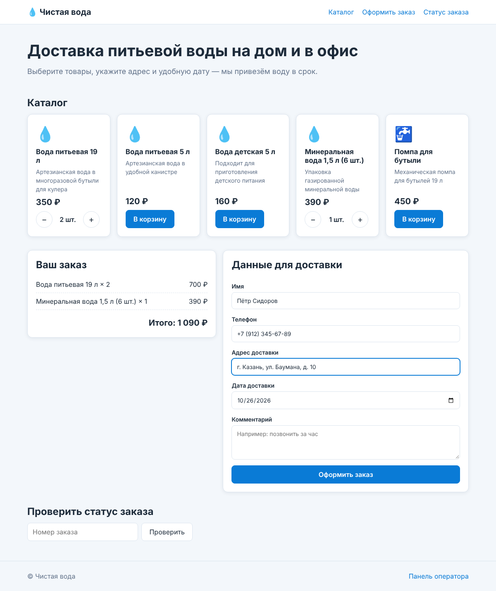
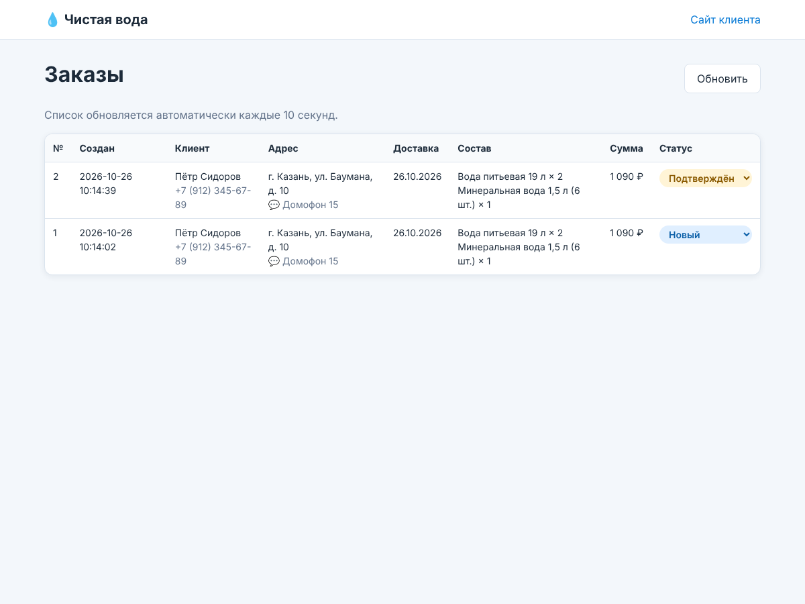

# Система заказа воды

Система для заказа доставки питьевой воды, написанная на **C++**. Сервер сделан на библиотеке
[cpp-httplib](https://github.com/yhirose/cpp-httplib) и встроен в сайт клиента:
клиент выбирает воду на сайте и отправляет заказ, сервер проверяет его,
считает сумму и сохраняет. Оператор видит все заказы и меняет их статус.



## Что сделано по заданию

| № | Пункт задания | Где в проекте |
|---|---|---|
| 1 | Создание репозитория и структуры | Этот репозиторий, [структура](#структура-проекта), `CMakeLists.txt`, `.gitignore` |
| 2 | Подключение библиотеки HTTP | `third_party/httplib.h` (cpp-httplib), подключается в `server/api.hpp` |
| 3 | Разработка сервера | `server/`: REST API, проверка заказов, хранение в `orders.json` |
| 4 | Разработка клиента | `client/`: сайт клиента `index.html` и панель оператора `admin.html` |
| 5 | +1 балл: две диаграммы | [`docs/diagrams.md`](docs/diagrams.md): диаграмма последовательности и диаграмма классов |

## Возможности

**Сайт клиента** (`http://localhost:8080/`)
- каталог воды с ценами (загружается с сервера);
- корзина: можно добавить товары, изменить количество и сразу увидеть итоговую сумму;
- оформление заказа: имя, телефон, адрес, дата доставки и комментарий;
- сообщения об ошибках, если данные заполнены неверно;
- проверка статуса заказа по его номеру.

**Панель оператора** (`http://localhost:8080/admin.html`)
- таблица всех заказов, которая обновляется сама каждые 10 секунд;
- смена статуса заказа: Новый → Подтверждён → В пути → Доставлен / Отменён.

**Сервер**
- REST API в формате JSON;
- проверяет все данные заказа: телефон, адрес, дату не в прошлом, товары и количество;
- считает сумму заказа по ценам из каталога (сумме, присланной из браузера, сервер не доверяет);
- сохраняет заказы в файл `orders.json`, поэтому после перезапуска они не пропадают;
- безопасен для нескольких одновременных запросов (хранилище защищено `std::mutex`).

## Структура проекта

```
megacalulator/
├── CMakeLists.txt          — сборка проекта
├── run.bat                 — сборка и запуск на Windows одним кликом
├── server/                 — C++ сервер
│   ├── main.cpp            — точка входа: параметры запуска, старт сервера
│   ├── api.hpp/.cpp        — HTTP-маршруты (REST API)
│   ├── catalog.hpp/.cpp    — каталог товаров
│   ├── order.hpp/.cpp      — заказ, статусы, проверка данных
│   └── order_store.hpp/.cpp — хранилище заказов и сохранение в файл
├── client/                 — сайт клиента (HTML, CSS, JavaScript)
│   ├── index.html, app.js  — страница заказа
│   ├── admin.html, admin.js — панель оператора
│   ├── common.js           — общие функции (запросы к API)
│   └── style.css           — оформление
├── tests/tests.cpp         — модульные тесты логики заказов
├── docs/                   — диаграммы и скриншоты
└── third_party/            — сторонние библиотеки (только заголовочные файлы)
    ├── httplib.h           — cpp-httplib 0.18.3 (HTTP-сервер)
    └── nlohmann/json.hpp   — nlohmann/json 3.11.3 (работа с JSON)
```

Обе библиотеки состоят из одного заголовочного файла и уже лежат в репозитории,
поэтому ничего скачивать не нужно.

## Сборка и запуск

Нужен компилятор с поддержкой C++17 и [CMake](https://cmake.org/download/) 3.14 или новее.
На Windows подойдёт **Visual Studio 2019/2022** (компонент «Разработка классических приложений на C++»)
или **MinGW-w64** из [MSYS2](https://www.msys2.org/). Нужна Windows 10 или новее.

### Способ 1. Одной командой (Windows)

Дважды щёлкните `run.bat` или выполните его в cmd из папки проекта:

```cmd
run.bat
```

Скрипт соберёт проект и запустит сервер. Затем откройте в браузере http://localhost:8080

### Способ 2. Через cmd и CMake

```cmd
cd /d C:\путь\к\megacalulator
cmake -S . -B build
cmake --build build --config Release
build\Release\water_server.exe
```

Если вы собираете через MinGW, exe будет лежать в `build\water_server.exe`.

### Способ 3. Visual Studio

`Файл → Открыть → Папка…` → выберите папку проекта. Visual Studio сама найдёт `CMakeLists.txt`.
Выберите цель запуска `water_server.exe` и нажмите ▶.

### Способ 4. Только g++ (без CMake)

```cmd
g++ -std=c++17 -O2 -Iserver -Ithird_party -D_WIN32_WINNT=0x0A00 ^
    server/main.cpp server/api.cpp server/catalog.cpp server/order.cpp server/order_store.cpp ^
    -o water_server.exe -lws2_32
water_server.exe
```

На Linux/macOS вместо `-D_WIN32_WINNT=0x0A00 ... -lws2_32` укажите `-pthread`.

### Параметры запуска

```
water_server [--port 8080] [--client папка_сайта] [--data orders.json]
```

| Параметр | По умолчанию | Назначение |
|---|---|---|
| `--port` | `8080` | порт сервера |
| `--client` | ищется автоматически | папка с сайтом клиента |
| `--data` | `orders.json` | файл, в котором хранятся заказы |

### Тесты

```cmd
ctest --test-dir build -C Release --output-on-failure
```

## REST API

Все ответы приходят в формате JSON. При ошибке сервер возвращает `{"errors": ["описание", ...]}`.

| Метод | Адрес | Что делает | Ответ |
|---|---|---|---|
| `GET` | `/api/health` | проверка, что сервер работает | `200` |
| `GET` | `/api/products` | каталог товаров | `200` |
| `POST` | `/api/orders` | оформить заказ | `201` заказ / `400` ошибки |
| `GET` | `/api/orders` | все заказы | `200` |
| `GET` | `/api/orders/{id}` | один заказ | `200` / `404` |
| `PATCH` | `/api/orders/{id}/status` | изменить статус | `200` / `400` / `404` |

Пример заказа:

```json
POST /api/orders
{
  "customer_name": "Иван Петров",
  "phone": "+7 (900) 123-45-67",
  "address": "г. Москва, ул. Ленина, д. 1, кв. 5",
  "delivery_date": "2026-10-27",
  "comment": "Позвонить за час",
  "items": [
    { "product_id": 1, "quantity": 2 },
    { "product_id": 5, "quantity": 1 }
  ]
}
```

Статусы заказа: `new`, `confirmed`, `delivering`, `delivered`, `cancelled`.

Проверить API можно прямо из cmd. В Windows 10+ `curl` уже встроен:

```cmd
curl http://localhost:8080/api/products
curl -X PATCH http://localhost:8080/api/orders/1/status -d "{\"status\":\"delivering\"}"
```

## Диаграммы

В [`docs/diagrams.md`](docs/diagrams.md) лежат две диаграммы, GitHub показывает их прямо на странице:

1. **Диаграмма последовательности.** Как проходит заказ: сайт → сервер → проверка → хранилище → файл, и как оператор меняет статус.
2. **Диаграмма классов.** Классы сервера (`Catalog`, `Product`, `Order`, `OrderItem`, `OrderStatus`, `OrderStore`) и их связи.

Картинки для отчёта: `docs/sequence.png` и `docs/classes.png`.



## Работа с git через cmd

### Скачать проект к себе на компьютер

```cmd
cd /d C:\Projects
git clone https://github.com/Chechel1858/megacalulator.git
cd megacalulator
```

Если git ещё не настроен, один раз укажите имя и почту:

```cmd
git config --global user.name "Ваше Имя"
git config --global user.email "ваша@почта"
```

### Каждый раз после изменений

```cmd
git status
git add .
git commit -m "Что сделали"
git push
```

`git status` показывает, что изменилось, `git add .` добавляет изменения,
`git commit` сохраняет их локально, а `git push` отправляет на GitHub.

Забрать изменения с GitHub: `git pull`.

### Зачем нужен .gitignore

`.gitignore` говорит git, какие файлы **не надо** добавлять в репозиторий:
скомпилированные файлы (`.exe`, `.obj`, `.o`), папку сборки `build/`, служебные папки
Visual Studio (`.vs/`) и файл с заказами `orders.json`. В репозитории хранится только
исходный код, а всё остальное каждый собирает у себя.

## Ограничения

Это учебный проект. Панель оператора и API не защищены паролем, поэтому сервер стоит
запускать только в локальной сети. Для реального магазина понадобятся авторизация
оператора и HTTPS.

## Лицензии сторонних библиотек

- cpp-httplib: MIT, `third_party/licenses/cpp-httplib-LICENSE.txt`
- nlohmann/json: MIT, `third_party/licenses/nlohmann-json-LICENSE.txt`
