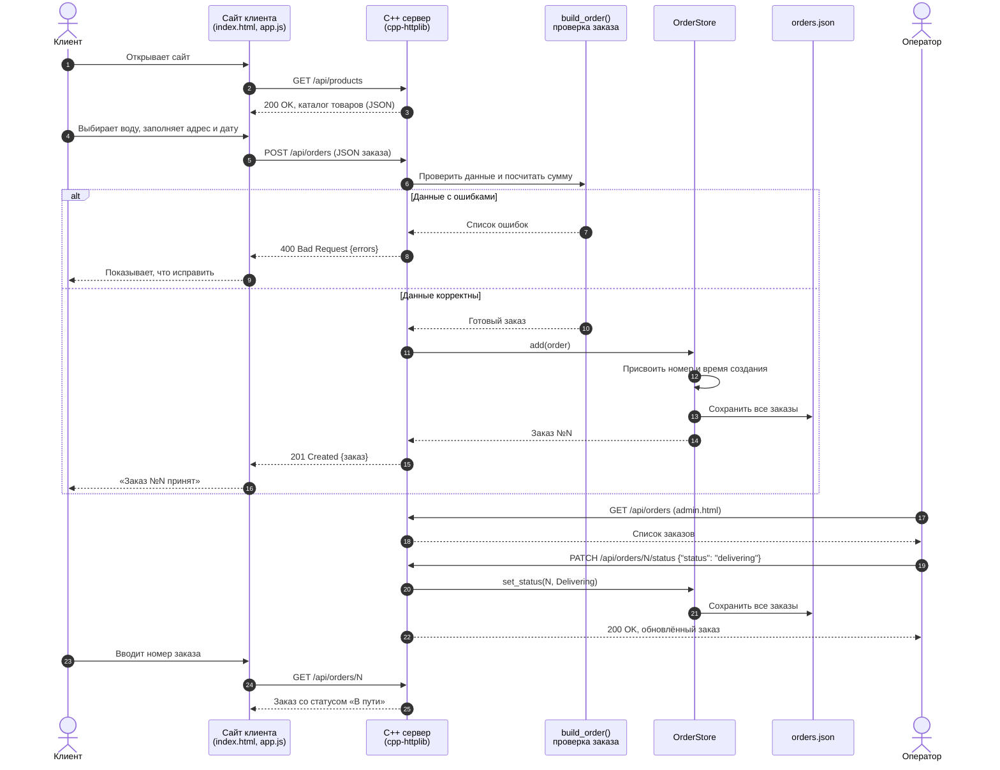
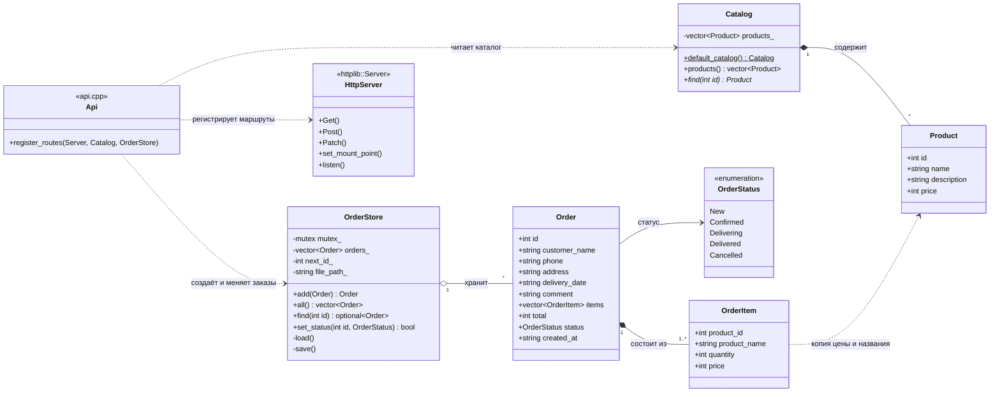

# Диаграммы системы заказа воды

Все диаграммы есть в формате **draw.io**: их можно открыть и редактировать на [app.diagrams.net](https://app.diagrams.net/)
через «Файл → Открыть» или в приложении draw.io.

| Диаграмма | draw.io | Картинка |
|---|---|---|
| Варианты использования (Use Case) | [`use-case.drawio`](use-case.drawio) | [`use-case.png`](use-case.png) |
| Последовательность | [`sequence.drawio`](sequence.drawio) | [`sequence.png`](sequence.png) |
| Классы | [`classes.drawio`](classes.drawio) | [`classes.png`](classes.png) |

Ниже те же диаграммы последовательности и классов на [Mermaid](https://mermaid.js.org/), GitHub рисует их прямо на этой странице.

## 1. Диаграмма последовательности: оформление заказа

Показывает, что происходит, когда клиент оформляет заказ на сайте и когда оператор меняет его статус.

## 2. Диаграмма классов: устройство сервера

Показывает, из каких классов состоит C++ сервер и как они связаны.

